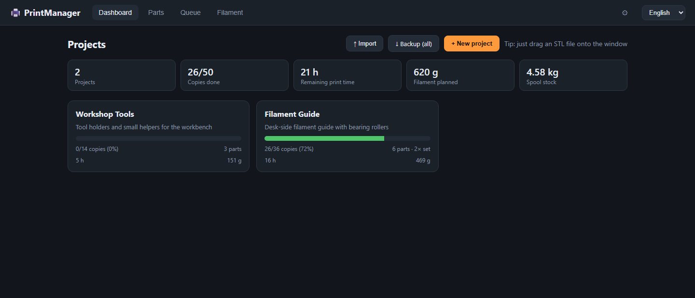
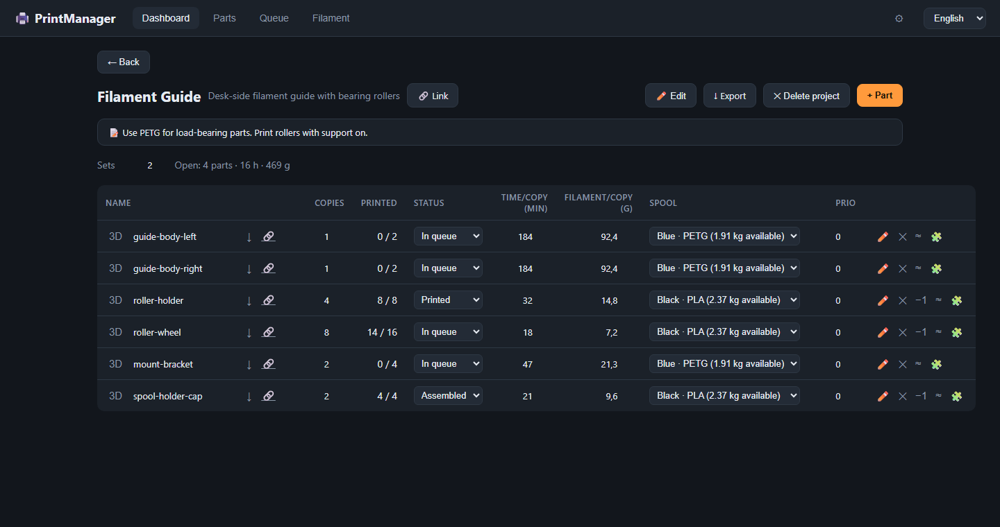
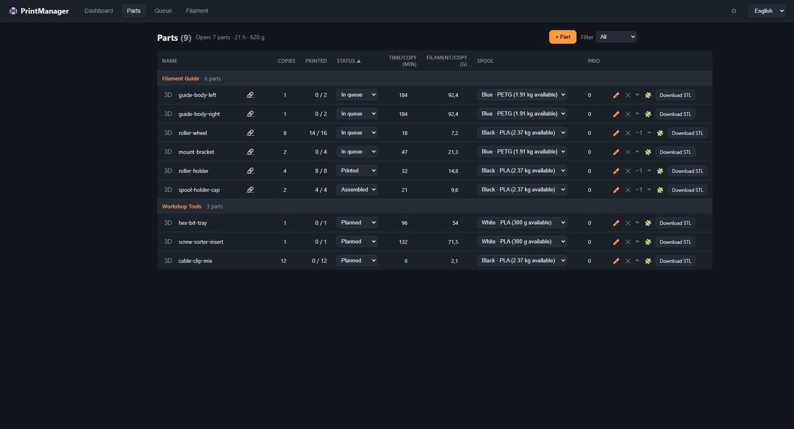
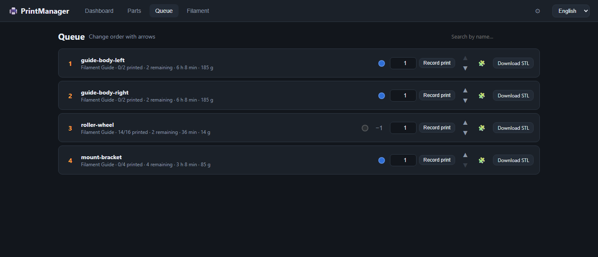
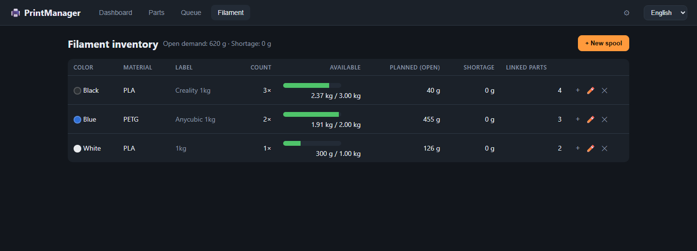

# PrintManager

A local web app for managing 3D-printing projects, parts, STL files, print queues, and filament inventory. The UI is available in English and German.

This project was created with assistance from AI tools.

## Features

- Manage projects with a description, notes, URL, and number of print runs
- Manage parts across projects: status, priority, copies per set, print time, filament, spool, and STL
- Group parts by project and edit fields directly in tables
- Upload STLs by drag and drop or from a part form; preview them interactively and download the original files
- Open an STL in the configured slicer on the computer running PrintManager
- Slice an STL using Anycubic Slicer Next and automatically apply estimated print time and filament per copy
- Choose printer, process, and filament profiles globally or override them for one slicing run
- Track partial printing, return defective copies without refunding consumed filament, or undo a mistaken completion with a filament refund
- View planned filament demand and shortages per spool group
- Export individual projects or a complete backup, including STL files, as ZIP archives

## Screenshots

The screenshots use synthetic demo data; no personal projects or STL files are included.

<details>
<summary>View screenshots</summary>

### Dashboard


### Project details


### Parts list


### Print queue


### Filament inventory


</details>

## Requirements

- Python 3.10 or newer; Python 3.13 is recommended
- Flask 3.1
- A modern WebGL-capable browser for the STL preview

Node.js is not needed at runtime. Three.js, STLLoader, and OrbitControls are bundled locally under `static/vendor/`; the preview does not require a CDN connection.

## Install and run on Windows

Open PowerShell in the project directory:

```powershell
python -m pip install -r requirements.txt
python app.py
```

Or double-click `start.bat` to start the server and open the local page in a browser.

Open the app at:

- Same computer: `http://localhost:5000`
- Local network: `http://<host-ip>:5000`
- Tailscale: `http://<tailscale-ip>:5000`

The server binds to `0.0.0.0` by default so other devices can connect. There is **no authentication, HTTPS, or access control**. Use only on trusted networks or a properly secured Tailscale network; do not expose port 5000 directly to the public internet.

Stop a foreground server with `Ctrl+C`.

## Data and configuration

Runtime data is stored in the project directory by default:

- `data.db` — SQLite database
- `files/` — uploaded original files
- `settings.json` — local settings, including slicer path and selected default profiles
- `server.log` — optional server log if output is redirected at launch

These files are ignored by Git and should not be committed.

The following environment variables can be set before launch:

| Variable | Default | Purpose |
| --- | --- | --- |
| `PM_DB` | `data.db` in the project directory | SQLite database path |
| `PM_FILES` | `files/` in the project directory | Uploaded files directory |
| `PM_SETTINGS` | `settings.json` in the project directory | Settings file path |
| `PM_PORT` | `5000` | HTTP port |
| `PM_SLICE_TIMEOUT` | `300` | Slicing timeout in seconds |

The parent directory for `PM_DB` must exist. The `PM_FILES` directory is created at startup if its parent exists. Both locations must be writable. Example:

```powershell
$env:PM_PORT = "5001"
python app.py
```

The database is created and additively migrated at startup. Export a full backup via **Dashboard → Backup (all)** before database changes or restores.

## Using the app

### Projects and parts

Open a project from the dashboard to manage its parts. The **Parts** tab groups all parts by project. Name, copies, status, print time per copy, filament per copy, spool, and priority can be edited directly in tables; changes are saved when a field loses focus.

Set a project's **Runs** to print the complete set more than once. A part's `copies` value is per set; total demand is `copies × runs`. Increasing runs can put completed parts back in the queue. Decreasing runs marks parts complete when enough copies have already been recorded. Runs can be changed in the project dialog or directly in the project view.

Project fields:

- Name
- Description
- Multi-line notes
- URL, displayed as a link in the project view

### STL files

Drop an STL onto the browser window or select one from **+ Part**. During upload, choose an existing project or create one. When uploading from a project view, that project is preselected. The upload dialog also lets you select copies and a filament spool.

The preview is interactive and generated in the browser from the stored STL; no separate preview image is saved. Downloads return the original file. STL is supported for upload and preview. 3MF files can be referenced by local path or URL but are not accepted by the upload dialog.

### Slicer and automatic estimates

Configure the slicer under **Settings**. **Detect** checks known install locations for Anycubic Slicer Next and Anycubic Slicer. Opening an STL with the slicer button creates a temporary copy with the original filename in `%TEMP%\printmanager\` and passes it to the slicer.

For Anycubic, Orca, and Bambu slicers, `--single-instance` is passed so subsequent files are sent to the running slicer instance rather than opening another window.

Select default **Printer**, **Process**, and **Filament** profiles in Settings. The clock button on a part opens a slicing dialog where the profiles can be overridden for that run. Anycubic Slicer Next slices headlessly with automatic orientation (`--orient 1`); the resulting G-code is parsed for print time and filament usage, which are saved per copy. Slicing is local-only, requires compatible profiles, and has a 300-second default timeout configurable with `PM_SLICE_TIMEOUT`.

Opening the slicer, selecting profiles, and slicing are restricted to the computer running the server (loopback). From other network devices, these actions return an error. The slicer itself always opens on the server computer.

### Queue and print progress

Part statuses are **Planned**, **In queue**, **Printed**, and **Assembled**. In the queue, enter how many copies were printed in the current run and click **Record print**. Partial runs stay in the queue with progress shown; a part changes to **Printed** when the required quantity (`copies × project runs`) is reached.

Changing a table status to **Printed** or **Assembled** manually marks all required copies as printed. Resetting a completed part to an open status clears its print progress and reverses the filament booking.

The **−1** action removes one printed copy from the completed quantity and returns the part to the queue. Choose why:

- **Defective** — the filament remains consumed as waste.
- **Mis-click** — the filament is credited back to the spool.

This action is available in the Parts tab, project view, and for partial parts in the queue.

### Filament inventory

Parts can be assigned to spool groups. Filament is booked when printed copies are recorded: `filament per copy × copies printed`. Partial print runs book only the corresponding amount.

The **Filament** tab shows stock, open planned demand, and shortage per spool group. Available stock is calculated as `remaining weight on the current spool + (spool count − 1) × weight per spool`. Open demand accounts for project runs and already printed copies. Demand without a spool assignment is listed separately.

The spool count represents identical spools; total and remaining weights are maintained per spool. Refilling adds a weight in grams. If the amount crosses full-spool boundaries, the count and remainder are adjusted accordingly. Consumption advances through spools one at a time.

### Import and export

- **Project view → Export** exports that project, its parts, referenced spools, and files.
- **Dashboard → Backup (all)** exports every project, spool, and STL file.
- **Dashboard → Import → Merge** adds imported projects and spools without replacing existing data.
- **Dashboard → Import → Overwrite** deletes all existing projects, parts, and spools before restoring the archive. Make a backup first.

ZIP archives contain a versioned `manifest.json` and referenced files. The current export format is version 3; versions 1 and 2 are still accepted. Newer unsupported versions are rejected.

## API overview

The Flask server provides the JSON API. Mutation routes generally expect JSON unless noted otherwise.

| Method | Route | Purpose |
| --- | --- | --- |
| `GET` | `/api/projects` | Projects, progress, and totals |
| `POST` | `/api/projects` | Create a project |
| `GET` | `/api/projects/<id>` | Get one project |
| `PUT` | `/api/projects/<id>` | Update a project |
| `DELETE` | `/api/projects/<id>` | Delete a project and its parts/files |
| `GET` | `/api/parts?project_id=<id>&status=<status>` | List parts; filters are optional |
| `POST` | `/api/parts` | Create a part; JSON or multipart with `file` |
| `GET` | `/api/parts/<id>` | Get one part |
| `PUT` | `/api/parts/<id>` | Update part fields or status |
| `POST` | `/api/parts/<id>/print` | Record printed copies (`{"copies": n}`) |
| `POST` | `/api/parts/<id>/unprint` | Return printed copies to the queue; `refund` controls filament refund |
| `DELETE` | `/api/parts/<id>` | Delete a part and refund booked filament |
| `POST` | `/api/parts/<id>/file` | Replace the STL (multipart) |
| `GET` | `/api/parts/<id>/file` | Download the original file |
| `POST` | `/api/parts/<id>/open-explorer` | Show the source file in Windows Explorer |
| `POST` | `/api/parts/<id>/open-slicer` | Open the STL in the configured slicer (local only) |
| `POST` | `/api/parts/<id>/slice` | Slice an STL and save time/filament estimates (local only) |
| `GET` | `/api/slicer/profiles` | List printer, process, and filament profiles (local only) |
| `GET`, `PUT` | `/api/settings` | Read/update settings and slicer profiles (local only) |
| `POST` | `/api/queue/reorder` | Reorder the queue (`{"ids": [...]}`) |
| `GET`, `POST` | `/api/spools` | List/create spools |
| `PUT`, `DELETE` | `/api/spools/<id>` | Update/delete a spool |
| `POST` | `/api/spools/<id>/refill` | Add filament (`{"amount_g": n}`) |
| `GET` | `/api/stats` | Dashboard statistics |
| `GET` | `/api/export/project/<id>` | Download a project ZIP |
| `GET` | `/api/export/full` | Download a full backup |
| `POST` | `/api/import` | Import a ZIP; multipart fields `file`, `mode` (`merge`/`restore`) |

API error messages follow the request's `Accept-Language` header (`en`/`de`).

## Development and tests

There is currently no separate test/build system. Syntax checks:

```powershell
python -m py_compile app.py
Copy-Item static\app.js $env:TEMP\appcheck.mjs
node --check $env:TEMP\appcheck.mjs
```

Backend tests should use Flask's test client with a temporary SQLite database (`PM_DB`) and file directory (`PM_FILES`). Never run restore-import, delete, or migration tests against a personal `data.db`.

## Project layout

```text
app.py                         Flask API, SQLite, uploads, migrations, import/export, slicing
static/index.html              HTML structure and dialogs
static/app.js                  UI, events, tables, STL preview
static/i18n.js                 English/German translations
static/style.css               Styling
static/vendor/                 Locally bundled Three.js modules
files/                         Runtime uploads; not versioned
settings.json                  Local settings; not versioned
data.db                        Runtime database; not versioned
```

---

# Deutsch

Eine lokale Web-App zur Verwaltung von 3D-Druckprojekten, Teilen, STL-Dateien, Druckwarteschlange und Filamentbestand. Die Oberfläche ist auf Deutsch und Englisch verfügbar.

Dieses Projekt wurde mit Unterstützung von KI-Tools erstellt.

## Funktionen

- Projekte mit Beschreibung, Notiz, URL und Anzahl an Durchläufen verwalten
- Teile projektübergreifend verwalten: Status, Priorität, Kopien pro Satz, Druckzeit, Filament, Spule und STL
- Teilelisten nach Projekt gruppieren; Felder direkt in Tabellen bearbeiten
- STL per Drag-and-drop oder im Teile-Dialog hochladen, interaktiv in 3D ansehen und Original herunterladen
- STL im konfigurierten Slicer auf dem Rechner öffnen, auf dem der PrintManager läuft
- STL mit Anycubic Slicer Next per CLI slicen und geschätzte Druckzeit sowie Filament pro Kopie automatisch übernehmen
- Drucker-, Prozess- und Filamentprofile als Standard wählen oder je Slicing-Lauf überschreiben
- Teilfortschritt erfassen, fehlerhafte Kopien ohne Filamenterstattung zurücknehmen oder eine versehentliche Fertigmeldung samt Filamentbuchung rückgängig machen
- Offenen Filamentbedarf und Fehlmengen je Spulengruppe anzeigen
- Einzelprojekte oder Komplettsicherungen einschließlich STL-Dateien als ZIP exportieren und importieren

## Screenshots

Die Screenshots verwenden ausschließlich synthetische Demodaten; persönliche Projekte und STL-Dateien sind nicht enthalten. Die englischsprachige Screenshot-Galerie steht oben im englischen Abschnitt.

## Voraussetzungen

- Python 3.10 oder neuer; Python 3.13 wird empfohlen
- Flask 3.1
- Aktueller Browser mit WebGL-Unterstützung für die STL-Vorschau

Node.js wird zur Laufzeit nicht benötigt. Three.js, STLLoader und OrbitControls sind lokal unter `static/vendor/` eingebunden; für die Vorschau ist keine CDN-Verbindung nötig.

## Installation und Start unter Windows

PowerShell im Projektverzeichnis öffnen:

```powershell
python -m pip install -r requirements.txt
python app.py
```

Alternativ `start.bat` doppelklicken, um den Server zu starten und die lokale Seite im Browser zu öffnen.

Die App ist erreichbar unter:

- Auf demselben Rechner: `http://localhost:5000`
- Im lokalen Netz: `http://<IP-des-Rechners>:5000`
- Über Tailscale: `http://<Tailscale-IP>:5000`

Der Server bindet standardmäßig an `0.0.0.0`, damit andere Geräte ihn erreichen können. Es gibt **keine Anmeldung, HTTPS- oder Berechtigungsprüfung**. Nur in vertrauenswürdigen Netzwerken bzw. über ein entsprechend abgesichertes Tailscale-Netz verwenden; Port 5000 nicht ungeschützt ins Internet freigeben.

Einen im Vordergrund laufenden Server mit `Ctrl+C` beenden.

## Daten und Konfiguration

Laufzeitdaten liegen standardmäßig im Projektverzeichnis:

- `data.db` – SQLite-Datenbank
- `files/` – hochgeladene Originaldateien
- `settings.json` – lokale Einstellungen, u. a. Slicer-Pfad und Standardprofile
- `server.log` – optionales Server-Log, falls die Ausgabe beim Start umgeleitet wird

Diese Dateien sind in `.gitignore` ausgeschlossen und gehören nicht ins Git-Repository.

Folgende Umgebungsvariablen können vor dem Start gesetzt werden:

| Variable | Standard | Zweck |
| --- | --- | --- |
| `PM_DB` | `data.db` im Projektordner | Pfad zur SQLite-Datenbank |
| `PM_FILES` | `files/` im Projektordner | Ordner für hochgeladene Dateien |
| `PM_SETTINGS` | `settings.json` im Projektordner | Pfad zur Einstellungsdatei |
| `PM_PORT` | `5000` | HTTP-Port |
| `PM_SLICE_TIMEOUT` | `300` | Zeitlimit für Slicing in Sekunden |

Der übergeordnete Ordner für `PM_DB` muss existieren; der Ordner für `PM_FILES` wird beim Start angelegt, sofern sein übergeordneter Ordner existiert. Beide Pfade müssen beschreibbar sein. Beispiel:

```powershell
$env:PM_PORT = "5001"
python app.py
```

Die Datenbank wird beim Programmstart angelegt bzw. mit erforderlichen Spalten erweitert. Vor Datenbankänderungen oder Wiederherstellungen empfiehlt sich ein Export über **Dashboard → Backup (alles)**.

## Bedienung

### Projekte und Teile

Auf dem Dashboard ein Projekt öffnen, um dessen Teile zu verwalten. Im Reiter **Teile** sind alle Teile projektweise gruppiert. Name, Kopien, Status, Druckzeit pro Kopie, Filament pro Kopie, Spule und Priorität lassen sich direkt in Tabellen bearbeiten; Änderungen werden beim Verlassen des Feldes gespeichert.

Mit **Durchläufe** lässt sich ein Projekt mehrfach drucken. Die Kopienzahl pro Teil gilt pro Satz; Gesamtbedarf ist `Kopien × Durchläufe`. Mehr Durchläufe können fertige Teile zurück in die Queue stellen. Weniger Durchläufe markieren Teile als fertig, wenn bereits genug gedruckt wurden. Durchläufe sind im Projekt-Dialog oder direkt in der Projektansicht änderbar.

Projektfelder:

- Name
- Beschreibung
- Mehrzeilige Notiz
- URL, die in der Projektansicht als Link erscheint

### STL-Dateien

STL-Dateien auf das Browserfenster ziehen oder über **+ Teil** auswählen. Beim Upload ein vorhandenes Projekt wählen oder ein neues anlegen. In der Projektansicht ist das aktuelle Projekt vorausgewählt. Kopien und Filamentspule lassen sich ebenfalls dort festlegen.

Die Vorschau wird interaktiv im Browser aus der gespeicherten STL erzeugt; ein separates Vorschaubild wird nicht gespeichert. Downloads liefern die Originaldatei zurück. STL wird für Upload und Vorschau unterstützt. 3MF kann über lokale Pfade/URLs referenziert werden, wird aber nicht über den Upload-Dialog angenommen.

### Slicer und automatische Schätzwerte

Unter **⚙ Einstellungen** den Slicer konfigurieren. **Automatisch suchen** prüft bekannte Installationspfade für Anycubic Slicer Next und Anycubic Slicer. Beim Öffnen per 🧩 wird eine temporäre STL-Kopie mit Originalnamen in `%TEMP%\printmanager\` erstellt und an den Slicer übergeben.

Für Anycubic, Orca und Bambu wird `--single-instance` verwendet, damit weitere Dateien in die laufende Slicer-Instanz geladen werden.

In den Einstellungen Standardprofile für **Drucker**, **Prozess** und **Filament** wählen. Der ⏱-Button öffnet für jedes Teil einen Slicing-Dialog, in dem Profile für diesen Lauf überschrieben werden können. Anycubic Slicer Next slict headless mit automatischer Ausrichtung (`--orient 1`); aus dem G-Code werden Druckzeit und Filament ermittelt und pro Kopie im Teil gespeichert. Slicing ist nur lokal möglich, benötigt kompatible Profile und hat standardmäßig ein Zeitlimit von 300 Sekunden (`PM_SLICE_TIMEOUT`).

Slicer öffnen, Profile lesen/speichern und Slicing sind auf den Rechner beschränkt, auf dem der Server läuft (Loopback). Der Slicer öffnet sich immer auf dem Server-Rechner.

### Queue und Druckfortschritt

Statuswerte: **Geplant**, **In Queue**, **Gedruckt**, **Montiert**. In der Queue eintragen, wie viele Kopien beim aktuellen Druck fertig wurden, und **Druck erfassen** klicken. Teilweise gedruckte Teile bleiben mit Fortschritt in der Queue. Nach der letzten benötigten Kopie (`Kopien × Durchläufe`) wechselt das Teil auf **Gedruckt**.

Ein manuelles Setzen auf **Gedruckt** oder **Montiert** markiert alle benötigten Kopien als gedruckt. Ein vollständig gedrucktes Teil auf **Geplant** oder **In Queue** zurückzusetzen löscht den Fortschritt und erstattet die zugehörige Filamentbuchung.

Die Aktion **−1** nimmt eine Kopie aus der Fertigmenge und stellt das Teil zurück in die Queue. Dabei wird nach dem Grund gefragt:

- **Fehlerhaft** – Filament bleibt als Ausschuss verbraucht.
- **Verklickt** – Filament wird der Spule gutgeschrieben.

Die Aktion ist in der Teileliste, Projektansicht und bei teilweise gedruckten Teilen in der Queue verfügbar.

### Filamentbestand

Teile können einer Spulengruppe zugewiesen werden. Filament wird beim Erfassen gedruckter Kopien gebucht: `Filament pro Kopie × gedruckte Kopien`. Teilweise Druckläufe buchen nur den entsprechenden Anteil.

Der Reiter **Filament** zeigt Bestand, offenen Bedarf und Fehlmenge je Spulengruppe. Verfügbarer Bestand ist `Restgewicht der angebrochenen Spule + (Anzahl − 1) × Gewicht pro Spule`. Offener Bedarf berücksichtigt Projektdurchläufe und bereits gedruckte Kopien. Bedarf ohne Spulenzuweisung wird separat angezeigt.

Die Anzahl bezeichnet gleichartige Spulen; Gesamt- und Restgewicht werden pro Spule geführt. Nachfüllen addiert Gramm. Werden volle Spulengewichte überschritten, erhöhen sich Spulenanzahl und Rest der letzten Spule. Verbrauch läuft Spule für Spule.

### Import und Export

- **Projektansicht → Export** exportiert das Projekt, seine Teile, zugewiesene Spulen und Dateien.
- **Dashboard → Backup (alles)** exportiert alle Projekte, Spulen und STLs.
- **Dashboard → Import → Anhängen** fügt zusätzliche Projekte und Spulen hinzu; bestehende Daten bleiben.
- **Dashboard → Import → Überschreiben** löscht alle vorhandenen Projekte, Teile und Spulen und stellt dann das Archiv wieder her. Vorher ein Backup anlegen.

ZIP-Dateien enthalten ein versioniertes `manifest.json` und die referenzierten Dateien. Aktuelles Format ist Version 3; Versionen 1 und 2 werden weiter importiert. Neuere, nicht unterstützte Versionen werden abgelehnt.

## API-Übersicht

Die Flask-API liefert JSON. Änderungsrouten erwarten JSON, außer bei Datei-Uploads.

| Methode | Route | Zweck |
| --- | --- | --- |
| `GET` | `/api/projects` | Projekte, Fortschritt und Summen |
| `POST` | `/api/projects` | Projekt erstellen |
| `GET` | `/api/projects/<id>` | Projekt abrufen |
| `PUT` | `/api/projects/<id>` | Projekt aktualisieren |
| `DELETE` | `/api/projects/<id>` | Projekt, Teile und Dateien löschen |
| `GET` | `/api/parts?project_id=<id>&status=<status>` | Teile auflisten; Filter optional |
| `POST` | `/api/parts` | Teil erstellen; JSON oder Multipart mit `file` |
| `GET` | `/api/parts/<id>` | Teil abrufen |
| `PUT` | `/api/parts/<id>` | Teilfelder oder Status aktualisieren |
| `POST` | `/api/parts/<id>/print` | Gedruckte Kopien erfassen (`{"copies": n}`) |
| `POST` | `/api/parts/<id>/unprint` | Kopien zurück in Queue; `refund` steuert Filamenterstattung |
| `DELETE` | `/api/parts/<id>` | Teil löschen und gebuchtes Filament zurückgeben |
| `POST` | `/api/parts/<id>/file` | STL ersetzen (Multipart) |
| `GET` | `/api/parts/<id>/file` | Originaldatei herunterladen |
| `POST` | `/api/parts/<id>/open-explorer` | Quelldatei im Windows-Explorer anzeigen |
| `POST` | `/api/parts/<id>/open-slicer` | STL im konfigurierten Slicer öffnen (nur lokal) |
| `POST` | `/api/parts/<id>/slice` | STL slicen und Zeit/Filament übernehmen (nur lokal) |
| `GET` | `/api/slicer/profiles` | Drucker-, Prozess- und Filamentprofile auflisten (nur lokal) |
| `GET`, `PUT` | `/api/settings` | Einstellungen und Slicerprofile lesen/speichern (nur lokal) |
| `POST` | `/api/queue/reorder` | Queue-Reihenfolge setzen (`{"ids": [...]}`) |
| `GET`, `POST` | `/api/spools` | Spulen auflisten/erstellen |
| `PUT`, `DELETE` | `/api/spools/<id>` | Spule aktualisieren/löschen |
| `POST` | `/api/spools/<id>/refill` | Filament nachfüllen (`{"amount_g": n}`) |
| `GET` | `/api/stats` | Dashboard-Statistiken |
| `GET` | `/api/export/project/<id>` | Projekt-ZIP herunterladen |
| `GET` | `/api/export/full` | Vollständiges Backup herunterladen |
| `POST` | `/api/import` | ZIP importieren; Multipart `file`, `mode` (`merge`/`restore`) |

API-Fehler folgen dem `Accept-Language`-Header (`de`/`en`).

## Entwicklung und Tests

Es gibt derzeit kein separates Test-/Build-System. Syntaxprüfungen:

```powershell
python -m py_compile app.py
Copy-Item static\app.js $env:TEMP\appcheck.mjs
node --check $env:TEMP\appcheck.mjs
```

Backendtests mit Flask-Testclient und temporärer SQLite-Datenbank (`PM_DB`) sowie temporärem Dateiordner (`PM_FILES`) ausführen. Restore-, Lösch- und Migrationstests niemals direkt gegen die persönliche `data.db` laufen lassen.

## Projektstruktur

```text
app.py                         Flask API, SQLite, Upload, Migration, Import/Export, Slicing
static/index.html              HTML-Struktur und Dialoge
static/app.js                  UI, Ereignisse, Tabellen, STL-Vorschau
static/i18n.js                 Englisch-/Deutsch-Übersetzungen
static/style.css               Darstellung
static/vendor/                 Lokal eingebundene Three.js-Module
files/                         Laufzeitdateien; nicht versioniert
settings.json                  Lokale Einstellungen; nicht versioniert
data.db                        Laufzeitdatenbank; nicht versioniert
```
